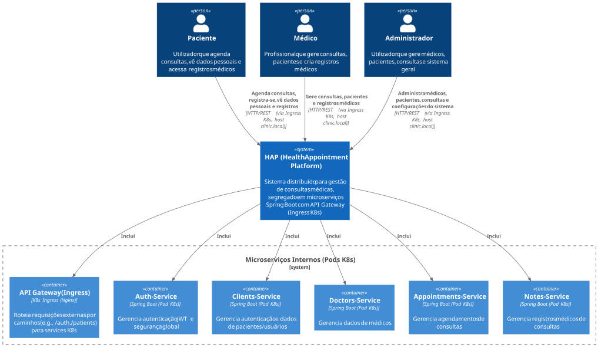
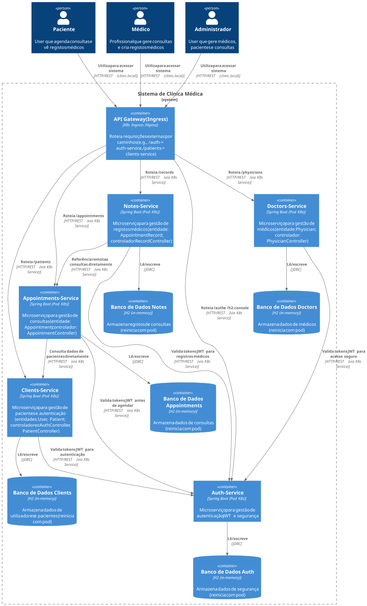
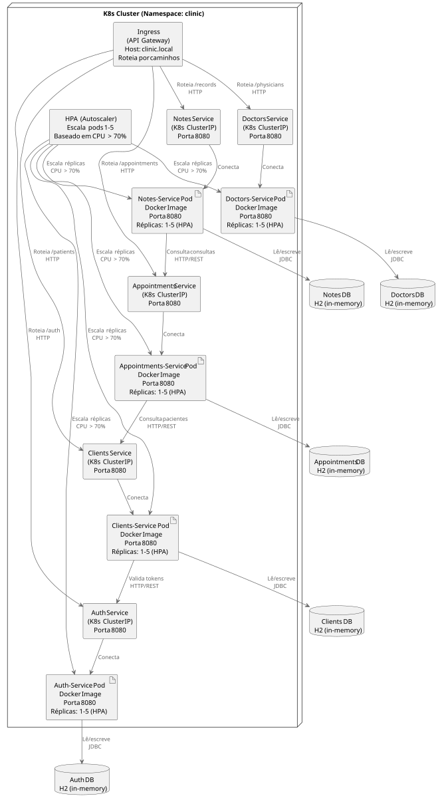
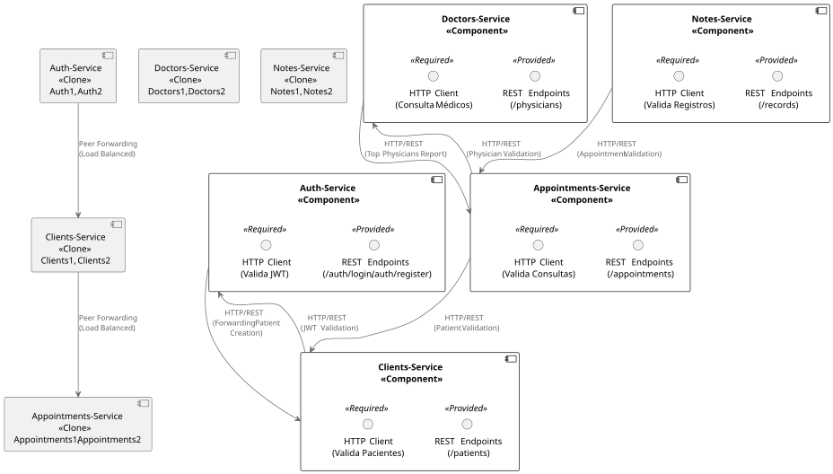
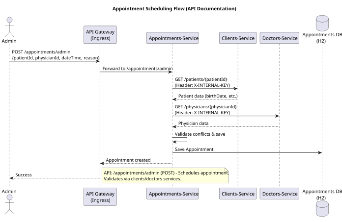

# LETI-SISDIS_2025_G5
## Trabalho realizado por:
- Carlos Cunha 1230717;
- Lucas Araújo 1230550;
- Eduardo Coelho 1230720;
# HAP (Health Appointment Platform)

Sistema distribuído para gestão de consultas médicas, segregado em microserviços Spring Boot.

## Arquitetura Geral

O HAP foi inicialmente um monólito e foi segregado em 5 microserviços independentes para melhor escalabilidade e manutenção:
- **Clients-Service:** Gerencia autenticação e dados de pacientes/usuários.
- **Doctors-Service:** Gerencia dados de médicos.
- **Appointments-Service:** Gerencia agendamentos de consultas.
- **Notes-Service:** Gerencia registros médicos de consultas.
- **Auth-Service:** Gerencia autenticação JWT e segurança global.

Cada serviço tem seu próprio banco de dados H2 isolado, facilitando testes e deployment independente. Comunicação via HTTP/REST com headers de segurança (X-INTERNAL-KEY) e validação JWT.

## Diagramas C4 / C4+1

- **System Context Diagram:** Mostra HAP interagindo com atores externos (pacientes, médicos, admins). 
- **Container Diagram:** Detalha containers (serviços + DBs) e conexões HTTP/REST. 
- **Physical View Diagram:** Mostra implantação física com K8s, pods, ingress, HPA e elasticidade. 
- **UML Component Diagram:** Componentes com interfaces (lollipops/sockets), instâncias (cloning) e dependências (HTTP/REST). 
- **Sequence Diagrams:** Fluxos de API (registo, agendamento, registos). ,  etc.
- **Class Diagrams:** Diagramas de classe para cada serviço, com entidades, controladores e relacionamentos. 
- **API_Overview.md**: Endpoints REST documentados. 

## Decisões Arquiteturais

- **Microserviços:** Escolhido para isolamento e escalabilidade, mas adiciona complexidade em comunicação (forwarding via WebClient/RestTemplate).
- **Bancos Isolados (H2):** Facilita testes unitários e evita dependências compartilhadas. Futuro: Migrar para PostgreSQL/MySQL em produção.
- **Segurança Centralizada:** Auth-Service gera/valida JWT, chamado por outros serviços para evitar duplicação.  Headers X-INTERNAL-KEY para comunicação interna.
- **Forwarding HTTP:** Usado para consultas entre serviços (e.g., Appointments chama Clients), sem API Gateway ainda.
- **Elasticidade:** HPA escala pods 1-5 baseado em CPU > 70%; réplicas evitam SPOF; fallbacks em clients para continuidade.
- **Spring Boot:** Framework rápido para prototipagem, com Maven para builds.
- **Limitações:** Sem containers Docker ainda; comunicação síncrona pode causar latência.

## Instruções de Deployment

### Pré-requisitos
- JDK 21 (ou superior).
- Maven 3.8+.
- Git para versionamento.
- (Para K8s) Minikube ou cluster K8s, Skaffold para CI/CD

### Rodar Localmente
1. Clone o repositório: `git clone <url>`.
2. Para cada serviço (e.g., clients-service):
    - Navegue: `cd clients-service`.
    - Rode: `mvn spring-boot:run`.
    - Acesse: http://localhost:8082 (porta varia por serviço).
3. Ordem sugerida: Auth-Service primeiro, depois Clients, Doctors, etc.

